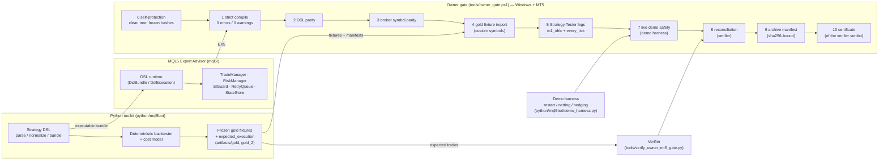

# AEGIS — showcase

An MT5 trading Expert Advisor, certified for **execution parity and safety
behaviour** by an evidence-bound gate that an AI-agent team built, ran and
debugged against real MetaTrader 5 terminals.

**Certificate:** [`certificate.md`](https://github.com/reiramin/mql5/blob/db13f551ce0c110b5fb91ab8445d5773ca1232df/reports/gate_run59/certificate/certificate.md)
· **Run report:** [gate_run59 `SUMMARY.md`](https://github.com/reiramin/mql5/blob/db13f551ce0c110b5fb91ab8445d5773ca1232df/reports/gate_run59/SUMMARY.md)
(branch `gate-reports`, commit `db13f55`).

> MT5 execution-parity and safety certificate, bar models, no real-tick
> claim, no profitability claim.

## What AEGIS is

- **An MQL5 Expert Advisor** (`mql5/`). It has five built-in strategy
  engines and an optional runtime for a certified, hash-bound DSL strategy
  bundle; the gold legs run through that runtime. Around them sit risk
  sizing, SL guarding, restart recovery, a retry queue and magic-number
  position ownership.
- **A Python toolkit** (`python/mql5bot/`). It holds the same DSL, a
  deterministic backtester and cost model, and frozen "gold" expectations
  of what the EA must do.
- **An owner gate** (`tools/owner_gate.ps1`). Eleven stages, 0-10, compile,
  test and reconcile the EA on a Windows MT5 terminal, and stop at the
  first failure.
- **A verifier** (`tools/verify_owner_mt5_gate.py`). It re-derives every
  verdict from the raw evidence and never trusts the gate's own claims.
- **The claim is narrow on purpose.** The EA executes the frozen
  expectation trade for trade, and behaves safely in 8 named failure
  situations. Nothing more is claimed.

## Architecture

## How the work was done: an AI-agent team

Three roles, each with its own scope and its own record.

| Role | Who | What it does | Its record |
|---|---|---|---|
| **Owner / reviewer** | a human | Sets the mission and the hard rules. Grants narrow, written exceptions (e.g. "the EA may wait for an unsynced symbol, bounded"). Reads each gate report. | `CLAUDE.md` exceptions, owner decisions in `docs/DECISIONS.md` |
| **Developer agent** | an AI coding agent in a cloud container | Root-causes each failure from the published raw logs. Fixes it on a branch and opens a PR with a self-review checklist. Merges with a runner tag. | PRs, `docs/DECISIONS.md`, `AUTONOMOUS_LOG.md`, `docs/BLOCKED.md` |
| **MT5 runner agent** | an AI agent on the owner's Windows machine | Watches master for a tagged merge (`[runner: full]`, `[runner: gold1]`, ...). Runs the gate on the real terminal and demo accounts. Publishes the evidence to the `gate-reports` branch after a leak check for credentials. | `reports/gate_run<N>/` on `gate-reports` |

**The developer agent's loop, every change:**

1. Read the newest report on `gate-reports`, quote the failing lines, and
   find the cause in the code. A symptom is never enough.
2. Fix it with tests. `ruff` and the **full** pytest suite must exit 0
   before any commit. The exit code is read from pytest itself, not from
   a summary line.
3. Open a PR with the self-review:
   - (a) does any acceptance rule get weaker?
   - (b) do the gold legs change behaviour at default inputs?
   - (c) does the verifier re-compute the new check?
4. Record the decision in `docs/DECISIONS.md` and the session in
   `AUTONOMOUS_LOG.md`. Merge with a runner tag, so the next gate run
   proves or refutes the fix.

**Hard rules every agent works under:**

- Never modify `evidence/`, `logs_owner/`, `certification_manifest.json`
  or the frozen gold artifacts by hand. The `mql5/` sources may change
  only under a named owner exception.
- Never loosen the verifier or any acceptance rule to get a pass.
- Never hand-type a hash. Every hash comes from a tool run.
- Never fabricate evidence or a result. Something built but never run
  is written "built, unit-tested, never run live".
- No credentials anywhere in the repo or the reports. They come from
  environment variables and a local accounts file outside the repo.
- No profitability claim, anywhere.

## The verification method

- **Golden fixtures.** Two frozen bar datasets, gold1 and gold2, each with
  the exact trade list the Python engine produces on it. The gate imports
  each one into MT5 as a custom symbol, and the round-tripped dataset hash
  must equal the manifest's.
- **Two tester models.** Each gold runs in the Strategy Tester under
  `m1_ohlc` and `every_tick`. Every entry is paired with the expected
  trade, and the first divergence is classified (`SIZING_MISMATCH`,
  `RISK_MISMATCH`, ...) and fails the stage by name.
- **Hash-bound evidence.** Every stage writes `stage_<n>.json` with sha256
  hashes of its artifacts. Stage 9's archive manifest binds the verifier
  report by hash.
- **Anchored frozen inputs.** `frozen_inputs.json` pins the gold artifacts
  by hash, and stage 0 refuses a dirty tree or a changed frozen hash. A
  re-anchor happens only under a written owner authorization, using the
  tools' own hashes.
- **Eight safety tests:**
  - five in the Strategy Tester, each an extra leg with a test hook that
    is off by default: kill switch, daily risk veto, lost order response,
    meta-allocation reduce, SL strip-and-restore;
  - three live on demo accounts: restart while a position is open (hard
    kill and relaunch), netting account, hedging account.
- **A certificate only from the verifier's verdict.** Stage 10 issues a
  certificate only when all of these hold:
  - the unscoped verdict is `MT5_VALIDATED_BAR_MODELS` (or
    `MT5_VALIDATED`);
  - nothing is missing;
  - both golds MATCH;
  - all 8 safety results are VALID;
  - the archive manifest binds that exact report.

  A run scoped to one gold is refused stages 9-10 outright.

## Real bugs the process found

Every one of these was found by a gate run failing, and fixed with a
test. The details are in `docs/DECISIONS.md`.

| ID | One line |
|---|---|
| **FILL-MODE-1** | The EA used an order-filling enum index as a bit of the broker's filling-mode mask, so on EURUSD it sent IOC, got `INVALID_FILL`, and had nothing to fall back to. |
| **S8-PATH-1** | The reference resolved a bar that touched both SL and TP stop-first, while MT5's M1-OHLC tick path (O-L-H-C on bullish bars) reaches the TP first. The equity under the next trade's size drifted, so gold1 trade 16 was sized 0.13 vs 0.14. |
| **RESTART-GRADE-1** | The restart grader ordered events by the EA's `TimeCurrent()` stamp, which is stale right after a relaunch. It now orders them by log position. |
| **SPEC-WAIT-1 / -2** | After a hard kill, the relaunched EA found the symbol not yet synced (`tick_value_loss <= 0`) and failed init, leaving a position unmanaged. It now waits in a bounded WAITING_SYMBOL state (no new positions), selects the symbol, and logs the spec values on each retry. |
| **HARNESS-SUSPEND-1** | A run spanned a 9-hour laptop sleep and the harness carried on. A wall-clock gap of more than 300 s now aborts the run as INTERRUPTED, and the gate fails it by name. |
| **STAGE8-EMPTY-NOTBUILT-1** | Under PowerShell StrictMode, reading the property names of an empty JSON object threw, and stage 8 crashed before the verifier ran. |
| **DEMO-CHECK-CRLF-1** | Windows text-mode writes turned `\r\n` into `\r\r\n` in a generated ini, so the connection check's export path carried a stray CR. |

## Numbers (from the reports)

- **Certified on gate_run59** (master `ab312d5`), and re-certified with
  the same results by gate_run60 (master `50cdb71`):
  - `GATE_RESULT=certified_with_log_graded_legs`;
  - stages 0-10 PASS;
  - verifier verdict `MT5_VALIDATED_BAR_MODELS`.
- **Gate runs.** The numbered owner-gate runs reached gate_run59. The
  `gate-reports` branch publishes the last 22 of them, gate_run38 to
  gate_run59.
- **gold1:** 18/18 entries paired in both tester models, 0 missing, 0
  extra.
- **gold2:** 37/37 entries paired in both tester models, 0 missing, 0
  extra.
- **Safety:** 8/8 VALID. Restart graded `RESTART_RECOVERED_NO_DUPLICATE`
  on a live demo account after a hard kill.
- **Leak check:** 0 hits across the 34 published files of gate_run59.

## How to reproduce

1. Windows host with MetaTrader 5 and MetaEditor, a clean clone, Python 3.10–3.12; the host must not sleep during the run.
2. For the live demo stage, a local demo-accounts file outside the repository (hedging + netting accounts), and FX market hours.
3. Run `powershell -ExecutionPolicy Bypass -File tools\owner_gate.ps1 -DataFolder "<MT5 data folder>" -DemoSafety` (the `[runner: full]` command).
4. Read `GATE_RESULT=` / `GATE_EXIT_CODE=` and `evidence\owner_gate\<UTC>\` (`stage_<n>.json`, `reconciliation_verify.json`, `certificate/`).
5. Everything else (runner tags, scoped runs, runner rules, what each stage checks): [OWNER_GATE.md](OWNER_GATE.md).

## Limitations (read these)

- **Bar models only.** `m1_ohlc` and `every_tick` over bar fixtures. There
  is no real-tick leg: the fixtures are bar-only, and that leg is recorded
  `NOT_APPLICABLE_BAR_ONLY_FIXTURE`, never as a pass.
- **Legs graded from the tester log.** MT5 wrote no report file for the
  gold legs, so every leg's trades come from the tester agent log. The
  result is therefore `certified_with_log_graded_legs`, never plain
  `certified` (exit code 1).
- **No profitability or robustness claim.** The certificate covers
  execution parity on two frozen fixtures and eight safety behaviours. It
  says nothing about returns, drawdowns or out-of-sample performance.
- **One broker, one symbol.** MetaQuotes-Demo, EURUSD (custom gold
  symbols for the tester legs, live EURUSD for the demo tests).
- **Not every path in the certified commit has run live.** The SPEC-WAIT-2
  retry path and the HARNESS-SUSPEND-1 abort path are built and
  unit-tested. gate_run59 needed neither, so neither has run live.
